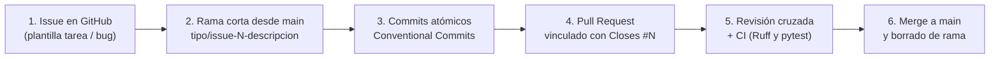

# Guía de Contribución · FacturaEC

Este documento define las reglas de gobierno, ramificación, mensajes de commit, pull requests y revisión cruzada para el repositorio de **FacturaEC** (Módulo 8 · Automatización de procesos de software · UPEC).

Todo integrante del equipo debe seguir este flujo de trabajo a partir del hito **H3 (`v0.3.0`)** conforme al estándar de gestión de configuración IEEE Std 828-2012 (IEEE, 2012) y las prácticas de desarrollo seguro NIST SSDF SP 800-218 (Souppaya et al., 2022).

---

## 1. Regla Principal de Gobierno

La rama `main` está **protegida**:
- **Prohibidos los commits directos a `main`**: todo cambio (código, contrato OpenAPI, pruebas, configuración o documentación) debe ingresar mediante una rama corta y un **Pull Request (PR)**.
- **Todo PR debe estar vinculado a un Issue** previo mediante la palabra clave `Closes #N` en su descripción.
- **Revisión cruzada obligatoria**: ningún integrante puede aprobar su propio PR. Se requiere al menos **1 aprobación con comentario sustantivo** de otro compañero del equipo y que las verificaciones automáticas pasen antes de fusionar (*merge*).

---

## 2. Flujo de Trabajo Paso a Paso (`Issue → Rama → PR → Revisión → Merge`)



### Paso 1 · Crear el Issue
Antes de escribir código o modificar documentación, cree un issue en la pestaña **Issues** usando una de las plantillas de `.github/ISSUE_TEMPLATE/`:
- **Tarea / Historia (`tarea.md`)**: para nuevas funcionalidades, documentos de arquitectura, reglas de linter o mejoras de proceso.
- **Reporte de defecto (`bug.md`)**: para errores detectados en pruebas BDD, validaciones del contrato o regresiones.

### Paso 2 · Crear una rama de vida corta
Sincronice siempre su copia local de `main` antes de abrir una rama nueva:

```bash
git checkout main
git pull origin main
git checkout -b <tipo>/issue-<numero>-<descripcion-corta>
```

**Convención de nombres de ramas:**
- `feat/issue-N-descripcion`: nueva funcionalidad de negocio en `src/` o `api/`.
- `fix/issue-N-descripcion`: corrección de un defecto en código, pruebas o contrato.
- `docs/issue-N-descripcion`: creación o actualización de ADR, matrices, guías o vistas C4.
- `chore/issue-N-descripcion`: configuración del repositorio, plantillas, dependencias o `.gitignore`.
- `ci/issue-N-descripcion`: flujos de integración continua en `.github/workflows/`.
- `test/issue-N-descripcion`: adición o ajuste de escenarios Gherkin y pruebas en `tests/`.

> **Duración de las ramas:** Las ramas deben ser cortas (acotadas a un solo issue) e integrarse a `main` en menos de 24–48 horas para reducir la probabilidad de conflictos de fusión (Forsgren et al., 2018).

### Paso 3 · Realizar commits atómicos con Conventional Commits
Cada commit debe representar un cambio lógico único y seguir la especificación **Conventional Commits 1.0.0** (Conventional Commits, s. f.):

```text
<tipo>(<alcance opcional>): <descripción breve en imperativo o presente, sin punto final>

[cuerpo opcional explicando el qué y el porqué]

Refs #N
```

**Tipos permitidos:**
| Tipo | Cuándo usarlo | Ejemplo en FacturaEC |
|---|---|---|
| `feat` | Nueva operación o regla de negocio | `feat(facturas): asigna secuencial bajo bloqueo de fila (#5)` |
| `fix` | Corrección de un defecto en API, contrato o pruebas | `fix(api): separa respuestas 409 de RUC duplicado y factura autorizada (#6)` |
| `docs` | Cambios exclusivos en documentación (`docs/`, `README`, `CONTRIBUTING`) | `docs(vcs): agrega matriz comparativa Git vs SVN (#4)` |
| `test` | Adición o corrección de pruebas en `tests/` | `test(bdd): agrega escenarios Gherkin de aislamiento E1 (#7)` |
| `chore` | Mantenimiento, plantillas, `.gitignore` o dependencias | `chore(repo): agrega plantillas de issue y actualiza .gitignore (#2)` |
| `ci` | Configuración de pipelines en `.github/workflows/` | `ci(actions): agrega workflow de validacion con Ruff y pytest (#3)` |
| `build` | Generación de artefactos o empaquetado (`pyproject.toml`, `generated/`) | `build(stubs): regenera stubs python-fastapi desde openapi.yaml (#8)` |

### Paso 4 · Verificación local antes de subir la rama
Si su cambio toca código Python (`src/` o `tests/`) o el contrato (`api/openapi.yaml`), ejecute localmente:

```bash
ruff check src tests
ruff format --check src tests
PYTHONPATH=src pytest -v
```

Si todo pasa sin errores, suba la rama:

```bash
git push -u origin <nombre-de-su-rama>
```

### Paso 5 · Abrir el Pull Request y vincular el Issue
1. En GitHub, abra el Pull Request desde su rama hacia `main`.
2. Complete todas las secciones de la plantilla `.github/pull_request_template.md`.
3. En la línea `Closes #`, escriba el número exacto del issue (por ejemplo, **`Closes #4`**) para que GitHub enlace el PR en la sección *Development* y cierre el issue automáticamente al fusionar.
4. Solicite la revisión (*Reviewers*) de al menos otro integrante del equipo.

### Paso 6 · Revisión cruzada con comentario sustantivo
El integrante revisor debe:
1. Revisar la pestaña **Files changed** del PR.
2. Completar la lista de verificación de la plantilla de PR.
3. Emitir su dictamen en **Review changes** (`Approve` o `Request changes`) acompañado de un **comentario sustantivo** que mencione qué se verificó específicamente (trazabilidad con escenarios/ADR, cumplimiento de normas APA o Gherkin, ausencia de secretos y resultado de las pruebas). No se admiten revisiones de una sola palabra («ok», «aprobado»).

---

## 3. Manejo y Prevención de Conflictos de Fusión (*Merge Conflicts*)

Si `main` avanzó mientras trabajaba en su rama y GitHub reporta conflicto:

1. Actualice la referencia remota y traiga `main` a su rama local:
   ```bash
   git fetch origin
   git merge origin/main
   ```
2. Abra los archivos marcados en conflicto y localice los delimitadores de Git (`<<<<<<< HEAD`, `=======`, `>>>>>>> origin/main`).
3. Acuerde con el autor del cambio concurrente la resolución correcta, elimine los marcadores y verifique que las pruebas y linters pasen.
4. Registre el commit de resolución y actualice el PR:
   ```bash
   git add <archivo-resuelto>
   git commit -m "chore(merge): resuelve conflicto en <archivo> integrando cambios de main"
   git push origin <nombre-de-su-rama>
   ```

---

## 4. Seguridad, Secretos y Dependencias

- **Cero secretos en el repositorio:** Nunca versione contraseñas, tokens JWT reales, cadenas de conexión (`DATABASE_URL`, `TEST_DATABASE_URL`), certificados de firma electrónica del SRI (`.p12`, `.pfx`) ni RUC/datos personales de clientes reales (LOPDP).
- **Dependencias:** Todo paquete nuevo en `pyproject.toml` debe justificarse en el PR, tener licencia libre compatible (MIT, BSD, Apache-2.0) y registrarse en `docs/10-gobierno-seguridad-y-dependencias.md`.

---

## 5. Versionado Semántico (SemVer) y Etiquetas de Hito

El proyecto utiliza **Semantic Versioning 2.0.0** (`MAJOR.MINOR.PATCH`) (Preston-Werner, s. f.) alineado a los hitos del módulo:

- **`v0.1.0` (Hito H1):** Dossier de arquitectura (contexto, drivers, escenarios E1–E8, vistas C4 y ADR iniciales).
- **`v0.2.0` (Hito H2):** Cadena CASE funcionando (mapa de toolchain, historias Gherkin, contrato OpenAPI validado con Spectral, documentación, mock, stubs, esqueleto FastAPI y pruebas BDD).
- **`v0.3.0` (Hito H3):** Repositorio gobernado (guía de contribución, plantillas, CI, flujo por PR con revisión cruzada, reporte de conflicto, matriz Git vs SVN, ADR de selección de VCS y auditoría de dependencias).
