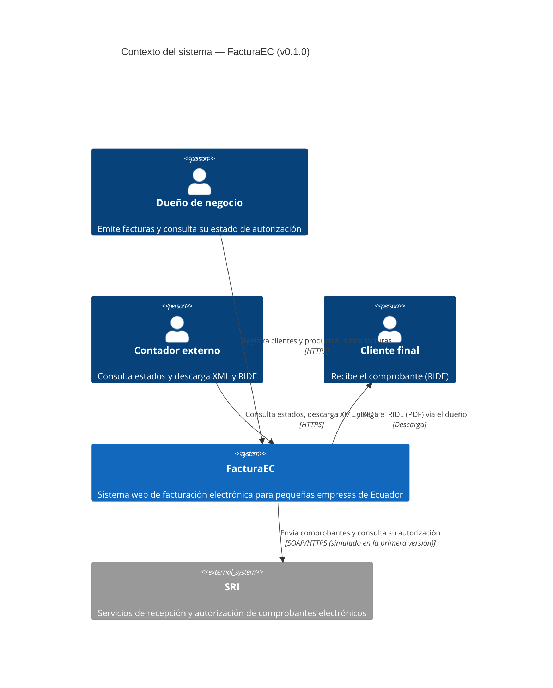

# C4 · Nivel 1 — Diagrama de contexto del sistema

Muestra a FacturaEC como una caja negra, las personas que lo usan y el sistema externo del que depende. El diagrama es código Mermaid y GitHub lo renderiza directamente.

## Elementos

| Nombre | Tipo | Responsabilidad |
|---|---|---|
| Dueño de negocio | Persona (S1) | Usuario principal; emite y consulta facturas |
| Contador externo | Persona (S2) | Consulta estados y descarga documentos |
| Cliente final | Persona (S6) | Recibe el comprobante |
| FacturaEC | Sistema | Gestiona clientes, productos y facturas; genera clave de acceso, XML y RIDE |
| SRI | Sistema externo (S3) | Autoriza los comprobantes; su disponibilidad no está bajo control del equipo |

## Coherencia con los escenarios

| Escenario | Qué se ve en esta vista |
|---|---|
| E2 (indisponibilidad del SRI) | La relación FacturaEC → SRI es la dependencia externa que puede fallar |
| E1 (aislamiento) | Cada dueño y contador interactúa solo con los datos de su propio emisor |
| E7 (primera factura) | El dueño es el actor principal del flujo de emisión |
