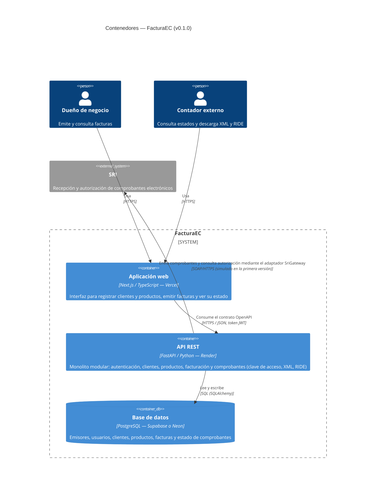

# C4 · Nivel 2 — Diagrama de contenedores

Detalla los contenedores desplegables de FacturaEC. Refleja la decisión de estilo del **ADR-003** (monolito modular): una sola API con módulos internos, no varios servicios. Refleja también el **ADR-004** (dos repositorios): `facturaec-frontend` contiene el contenedor «Aplicación web»; `facturaec-backend` contiene la «API REST» y la documentación.

## Elementos

| Contenedor | Tecnología | Responsabilidad | Repositorio |
|---|---|---|---|
| Aplicación web | Next.js / TypeScript (Vercel) | Presentación; no contiene reglas tributarias | `facturaec-frontend` |
| API REST | FastAPI / Python 3.12 (Render) | Reglas de negocio, seguridad, integración con el SRI | `facturaec-backend` |
| Base de datos | PostgreSQL (Supabase o Neon); SQLite solo en desarrollo | Persistencia y restricciones de integridad | `facturaec-backend` (modelos) |
| SRI | Sistema externo | Autorización de comprobantes | — |

*En v0.1.0 solo `docs/` y el `README` están presentes en `facturaec-backend`; la tabla indica dónde residirá cada contenedor.*

## Endpoints de la API (contrato)

| Método | Ruta | Función |
|---|---|---|
| POST | `/api/v1/auth/registro` | Crea emisor y usuario; devuelve token |
| POST | `/api/v1/auth/login` | Autenticación; devuelve token JWT |
| GET | `/api/v1/auth/me` | Datos del emisor autenticado |
| GET, POST | `/api/v1/clientes` | Listar y registrar clientes |
| GET | `/api/v1/clientes/{id}` | Consultar un cliente |
| GET, POST | `/api/v1/productos` | Listar y registrar productos |
| GET | `/api/v1/productos/{id}` | Consultar un producto |
| GET, POST | `/api/v1/facturas` | Listar (filtro `estado`) y crear facturas |
| GET | `/api/v1/facturas/{id}` | Consultar factura y estado |
| POST | `/api/v1/facturas/{id}/enviar-sri` | Enviar a autorización (200 o 202 si el SRI no está disponible) |
| GET | `/api/v1/facturas/{id}/ride` | Descargar RIDE en PDF |
| GET | `/api/v1/facturas/{id}/xml` | Descargar XML sin firmar |
| GET | `/health` | Verificación de estado |

El contrato completo se publica en `docs/openapi.json` (generado desde un prototipo de la API; ver «Otros usos de IA declarados» en el [registro de IA](../04-registro-ia.md)).

## Coherencia con los escenarios

| Escenario | Cómo se refleja en los contenedores |
|---|---|
| E1 (aislamiento) | Toda consulta de la API filtra por el emisor del token JWT; la base de datos mantiene `emisor_id` en cada tabla de negocio |
| E2 (SRI no disponible) | Solo el adaptador `SriGateway` de la API habla con el SRI; si falla, el estado queda en la base de datos como PENDIENTE |
| E3 (desempeño) | API y base de datos están en la ruta crítica de emisión; el SRI queda fuera de la medición |
| E4 (modificabilidad) | Los módulos internos de la API están acotados (ver `c3-componentes-api.md`) |
| E5 (despliegue) | Cada contenedor se despliega de forma independiente desde su repositorio |
| E6 (integridad) | La base de datos impone la restricción única de secuencial y el bloqueo de fila del emisor |
| E7 (usabilidad) | La aplicación web concentra la experiencia de usuario |
| E8 (SRI lento) | El adaptador `SriGateway` de la API corta cada intento por tiempo de espera y la factura queda PENDIENTE; el resto de las operaciones no dependen del SRI |
