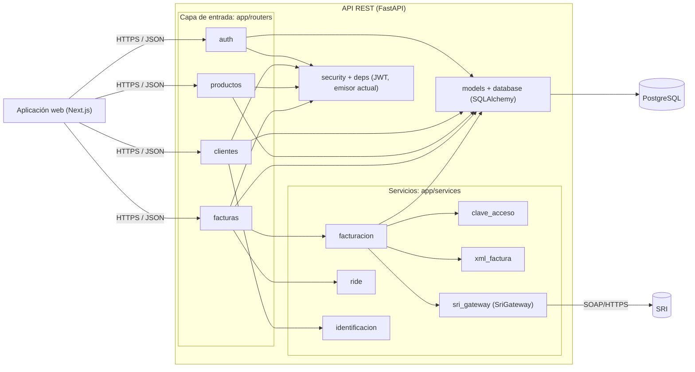

# Vista complementaria (C4 nivel 3) — Componentes de la API

Vista adicional, no exigida para el hito H1. Muestra los módulos internos del monolito modular y sirve de evidencia para los escenarios E2 y E4. Los nombres corresponden a la estructura de módulos prevista para el backend (carpeta `app/`, a incluir en el hito siguiente).

| Componente | Responsabilidad |
|---|---|
| `routers/*` | Contrato HTTP; validación de entrada con Pydantic |
| `security`, `deps` | Hash de contraseñas, JWT y resolución del emisor autenticado (E1) |
| `services/facturacion` | Cálculo de totales, asignación de secuencial bajo bloqueo (E6), reintentos al SRI (E2) |
| `services/clave_acceso` | Clave de 49 dígitos con dígito verificador módulo 11 |
| `services/xml_factura` | XML de factura 1.1.0 sin firmar |
| `services/ride` | PDF de representación impresa |
| `services/sri_gateway` | Puerto con adaptadores `SriGatewaySimulado` y `SriGatewayPruebas` (E2, E4) |

**Lectura para E4:** agregar la nota de crédito implica un nuevo `xml_*` y un caso de uso en `services/`; no toca `routers/auth`, `routers/clientes` ni `routers/productos`.
