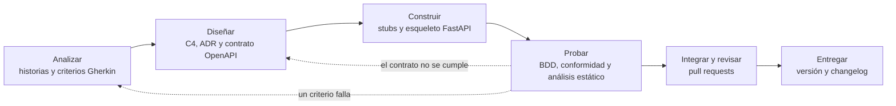

# 06 · Mapa de toolchain y priorización de tareas de alto volumen

> Proyecto **FacturaEC** · Módulo 8 · Semana 2 · versión v0.2.0.
> Referencias: ISO/IEC/IEEE 12207:2017 (procesos del ciclo de vida) e ISO/IEC 14102:2008 (evaluación y selección de herramientas CASE).

## 1. De analizar el producto a analizar el proceso

En el hito H1 (v0.1.0) se decidió **qué** construir y **cómo** estructurarlo: monolito modular en FastAPI con PostgreSQL y el SRI aislado detrás del adaptador `SriGateway` (ADR-001 a ADR-004), con los escenarios E1 a E8. Este documento analiza el **proceso** para construir y verificar FacturaEC, para decidir qué tareas conviene apoyar con herramientas CASE.

| Elemento | Estado al iniciar la semana 2 |
|---|---|
| Arquitectura | Monolito modular, adaptador `SriGateway`, dos repositorios (ADR-001 a ADR-004) |
| Artefactos existentes | `docs/01-contexto-y-drivers.md`, `docs/02-vistas-c4/`, `docs/03-adr/`, `docs/04-registro-ia.md` |
| Artefactos que se reutilizan | Escenarios E1, E2 y E6 (criterios y pruebas); tabla de endpoints de la vista C2 (base del contrato); ADR-002 (restricción única y bloqueo de fila); ADR-003 (adaptador del SRI) |
| Alcance de esta semana | Historias HU1 a HU7, contrato con 7 operaciones de negocio, esqueleto ejecutable con pruebas para E1, E2 y E6. Quedan fuera E8, el XML firmado, el RIDE y el frontend |
| Pendiente en este documento | Describir el proceso por fase, identificar diez tareas, puntuarlas, elegir herramientas por fase y registrar la prueba de las herramientas de las tres tareas priorizadas |

## 2. Paso 1 · Proceso del proyecto

Seis etapas, de los requisitos a la entrega. Los roles son ilustrativos y rotan entre hitos: con cuatro integrantes, una persona puede asumir más de un rol.

| Etapa | Artefactos | Rol responsable |
|---|---|---|
| Analizar | Historias HU con criterios CA en Gherkin; matriz de trazabilidad (`docs/07`) | Arquitecto |
| Diseñar | Vistas C4, ADR y contrato OpenAPI (`api/openapi.yaml`) | Arquitecto y responsable del contrato |
| Construir | Stubs generados y esqueleto del monolito modular (`src/`) | Equipo de desarrollo |
| Probar | Pruebas de aceptación BDD (E1, E2, E6), conformidad con el contrato y análisis estático | Responsable de calidad |
| Integrar y revisar | Pull requests con revisión cruzada y rúbrica | Responsable de repositorio |
| Entregar | Versión etiquetada (SemVer), `CHANGELOG.md` y documentación publicada | Responsable de repositorio |

## 3. Paso 2 · Diez tareas del proceso

Una tarea de alto volumen es repetitiva, frecuente, propensa a error y verificable.

| ID | Etapa | Tarea concreta | Frecuencia |
|---|---|---|---|
| T1 | Analizar | Redactar los criterios de aceptación en Gherkin a partir de los escenarios E1, E2 y E6, conservando su medida numérica | Por cada historia |
| T2 | Analizar | Mantener la trazabilidad historia → escenario → criterio → endpoint → ADR → prueba | En cada historia, criterio, endpoint o ADR nuevo o modificado |
| T3 | Diseñar | Actualizar las vistas C4 (Mermaid) cuando un ADR cambia contenedores o relaciones | Cuando cambia un ADR |
| T4 | Diseñar | Validar el contrato `api/openapi.yaml` con un linter antes de generar | En cada cambio del contrato |
| T5 | Diseñar | Generar la documentación HTML y levantar el servidor mock desde el contrato | En cada cambio del contrato |
| T6 | Construir | Generar el código base (stubs) de cada operación desde el contrato | Por cada operación y al regenerar tras un cambio del contrato |
| T7 | Probar | Escribir y ejecutar las pruebas de aceptación de E6 (1000 emisiones concurrentes contra PostgreSQL), E1 (aislamiento) y E2 (SRI caído) | En cada cambio del núcleo de facturación |
| T8 | Probar | Ejecutar el linter y el análisis estático del código Python | En cada commit |
| T9 | Integrar y revisar | Revisar el código y los pull requests con la rúbrica, en revisión cruzada | Por cada cambio a integrar |
| T10 | Entregar | Generar el changelog y el número de versión (SemVer) | En cada versión |

## 4. Paso 3 · Puntuación frecuencia × esfuerzo × riesgo

Escala de 1 a 5. El puntaje es el producto de los tres valores (máximo 125). Umbrales: **Alta** desde 60; **Media** de 20 a 59; **Baja** hasta 19. Los valores 2 y 4 se usan cuando la tarea queda entre dos descripciones.

| Criterio | 1 | 3 | 5 |
|---|---|---|---|
| Frecuencia | Una vez en el proyecto | Una vez por semana | En cada commit o varias veces al día |
| Esfuerzo (hecha a mano) | Una acción simple | Varios pasos manuales | Muchos pasos manuales que se repiten |
| Riesgo (si falla) | Se corrige sin consecuencias | Causa retrabajo, o un defecto que otra barrera de la cadena detecta antes de producción | Rompe directamente E1, E2 o E6 (prioridades 1 a 3 del dossier) y ninguna otra barrera lo detecta |

| ID | Tarea | F | E | R | Puntaje | Prioridad |
|---|---|---|---|---|---|---|
| **T7** | **Pruebas de aceptación de E6, E1 y E2** | 4 | 5 | 5 | **100** | **Alta** |
| **T4** | **Validar el contrato OpenAPI** | 4 | 4 | 4 | **64** | **Alta** |
| **T6** | **Stubs desde el contrato** | 4 | 4 | 3 | **48** | Media |
| T5 | Documentación y mock desde el contrato | 4 | 3 | 3 | 36 | Media |
| T9 | Revisión de pull requests | 4 | 3 | 3 | 36 | Media |
| T8 | Linter y análisis estático | 5 | 2 | 3 | 30 | Media |
| T2 | Trazabilidad HU → prueba | 3 | 3 | 3 | 27 | Media |
| T1 | Criterios en Gherkin | 3 | 3 | 2 | 18 | Baja |
| T3 | Actualizar las vistas C4 | 2 | 3 | 2 | 12 | Baja |
| T10 | Changelog y versión | 2 | 2 | 2 | 8 | Baja |

Las tres tareas priorizadas se eligen por orden de puntaje: **T7 (100), T4 (64) y T6 (48)**. Solo T7 y T4 superan el umbral Alta. T6 entra como tercera por puntaje y porque de ella depende el esqueleto ejecutable.

### 4.1 Justificación de cada valor (hecho observable)

| ID | Frecuencia (F) | Esfuerzo (E) | Riesgo (R) |
|---|---|---|---|
| T1 | 3: una vez por historia, del orden de una por semana en régimen normal. Esta semana fue excepcional (7 historias) porque se armó el backlog inicial. | 3: traducir cada escenario a Dado / Cuando / Entonces conservando la medida (por ejemplo, «0 duplicados en 1000 solicitudes» de E6). | 2: un criterio mal redactado se detecta al revisar la historia con la lista de ISO/IEC/IEEE 29148 (`docs/07`, sección 4). |
| T2 | 3: cambia con cada historia, criterio, endpoint o ADR. | 3: cruzar a mano seis artefactos (HU, E, CA, endpoint, ADR, prueba). | 3: una trazabilidad rota no detiene la API, pero oculta qué prueba revisar cuando cambia un escenario. Lo pide el docente (S5). |
| T3 | 2: solo cuando un ADR cambia contenedores; en esta semana, solo la referencia del contrato en la vista C2. | 3: editar el Mermaid y comprobar que GitHub lo renderiza. | 2: un diagrama desactualizado no afecta E1, E2 ni E6. |
| T4 | 4: el contrato cambió 3 veces en esta semana (borrador, corrección tras la revisión, ejemplos tras el mock). | 4: revisar a mano 8 operaciones, 16 esquemas, seguridad y códigos de estado en un YAML de unas 500 líneas. | 4: el contrato fija el 401 y el 404 de E1 y el 202 de E2. Un error se propaga a los stubs, a las pruebas y al futuro cliente del frontend (ADR-004). Se puntuó 4 y no 5 porque las pruebas de T7 son una segunda barrera (escala: queda entre 3 y 5). |
| T5 | 4: en cada cambio del contrato, igual que T4. | 3: generar el HTML y levantar Prism son dos comandos, más la revisión de lo generado. | 3: un mock desactualizado confunde al equipo del frontend, pero no afecta E1, E2 ni E6 en producción. |
| T6 | 4: 8 operaciones, regeneradas en cada cambio del contrato. | 4: escribir a mano rutas, modelos Pydantic, validaciones y códigos de respuesta de cada operación. | 3: un stub incorrecto lo detectan las pruebas de conformidad (`tests/test_contrato.py`), aunque podría afectar E1 de forma indirecta. |
| T7 | 4: en cada cambio del núcleo de facturación. | 5: E6 exige 1000 emisiones concurrentes contra PostgreSQL real, imposibles de reproducir a mano; E2 exige simular la caída del SRI y medir los intentos y las esperas. | 5: un secuencial duplicado es un comprobante rechazado por el SRI (R1, D1); una factura perdida rompe E2. La prueba encontró un defecto real en esta semana (sección 6). |
| T8 | 5: en cada commit. | 2: un solo comando (`ruff check`). | 3: detecta errores antes de la revisión, pero por sí solo no garantiza E1, E2 ni E6. |
| T9 | 4: a partir de v0.2.0 todo cambio entrará por pull request, varias veces por semana. Hasta la sesión 7 la práctica del módulo permite el commit directo a `main`, como se hizo en esta entrega. | 3: leer el cambio, aplicar la rúbrica, comentar y repetir. | 3: una revisión omitida deja pasar defectos, pero T7 y T8 actúan como segunda barrera. |
| T10 | 2: solo al etiquetar una versión (v0.1.0, v0.2.0). | 2: un comando y una revisión breve. | 2: un changelog incorrecto se corrige en la siguiente versión. |

## 5. Paso 4 · Herramienta por fase

La categoría depende de la función que cumple la herramienta en esa fase. **Upper CASE** apoya el análisis y el diseño; **Lower CASE**, la construcción, las pruebas y el mantenimiento; **I-CASE** integra ambas sobre un repositorio común. Las herramientas obligatorias de la cadena son gratuitas y de código abierto (R2). La única de pago, la IA, es un complemento opcional que puede sustituirse por la revisión cruzada humana (T9). La selección final se justifica con la matriz ponderada de [`08-matriz-seleccion.md`](08-matriz-seleccion.md) (ISO/IEC 14102).

| Fase | Tarea de mayor puntaje | Puntaje | Herramienta | Categoría |
|---|---|---|---|---|
| Analizar | T2 Trazabilidad | 27 | GitHub Issues y Projects y Gherkin (`.feature`) | Upper CASE |
| Diseñar | T4 Validar el contrato | 64 | Swagger Editor (edición), Spectral (linter) y Prism (mock) | Upper CASE |
| Construir | T6 Stubs | 48 | OpenAPI Generator 7.26.0 (`python-fastapi` y `html2`) | Lower CASE |
| Probar | T7 Pruebas de aceptación | 100 | pytest 9.1 + pytest-bdd 9.0 sobre PostgreSQL 16, con Claude Opus 5.5 como asistente | Lower CASE |
| Integrar y revisar | T9 Revisión de pull requests | 36 | GitHub (pull requests con `.github/pull_request_template.md`), revisión humana | Lower CASE |
| Entregar | T10 Changelog y versión | 8 | Git (etiqueta SemVer) y `CHANGELOG.md` escrito a mano; la herramienta de automatización se decide en la sesión 10 | Lower CASE |

**IA como herramienta CASE.** Claude Opus 5.5 se usó en dos funciones distintas, y su categoría cambia con la función: **Upper CASE** como revisor del contrato (T4) y como redactor de borradores de historias y criterios (T1), y **Lower CASE** como asistente que escribe los pasos de las pruebas (T7). En ningún caso decide: toda salida se verifica con ejecución real (Spectral, pytest, Prism) y queda en el [registro de IA](04-registro-ia.md).

**GitHub como I-CASE.** Si se mira el conjunto, GitHub reúne requisitos (issues), código, revisión y versiones sobre un mismo repositorio, que es la definición de I-CASE. En este mapa se clasifica por la función de cada fase: Upper CASE en el análisis (issues y tablero) y Lower CASE en la integración (pull requests).

### 5.1 Tareas priorizadas y habilitantes

Las **tareas priorizadas** son las de mayor puntaje: **T7, T4 y T6**. Sobre ellas se hicieron las pruebas de herramientas (sección 6). Las **tareas habilitantes** se ejecutaron aunque tengan menor puntaje, porque la cadena las necesita:

- **T1:** alimenta las pruebas.
- **T2:** trazabilidad mediante la matriz de `docs/07` y etiquetas Gherkin (`@HU`, `@CA`, `@E`).
- **T5:** mock y documentación.
- **T8:** linter.
- **T9:** plantilla de revisión.

**T3** no se ejecutó, porque ningún ADR cambió contenedores. **T10** queda diferida: esta semana solo se agrega el `CHANGELOG.md` manual.

### 5.2 Riesgo de uso y forma de verificar

El riesgo de uso es el riesgo de confiar en la herramienta sin comprobar su resultado.

| Tarea | Tipo | Herramienta | Riesgo de uso | Cómo se verifica |
|---|---|---|---|---|
| T7 Pruebas | Priorizada | pytest-bdd, con Claude como asistente | **Alto:** una prueba escrita por IA puede pasar sin probar nada y dar falsa seguridad sobre E6 | Ejecutar CA5.3 contra PostgreSQL; prueba de mutación: quitar el bloqueo de fila y comprobar que la prueba falla |
| T4 Contrato | Priorizada | Spectral, Redocly CLI y Claude revisor | **Medio:** un linter aprueba un contrato sintácticamente válido aunque rompa un criterio | Spectral sin hallazgos y contraste de cada hallazgo de la IA contra el archivo y los criterios |
| T6 Stubs | Priorizada | OpenAPI Generator | **Medio:** el stub arranca, pero no implementa nada y descarta el token | El stub expone las 8 rutas del contrato; `tests/test_contrato.py` compara contrato y código en cada ejecución |
| T1 Criterios | Habilitante | Gherkin, con borrador de IA revisado | **Medio:** un criterio puede perder la medida del escenario | Cada criterio conserva la medida de su escenario; `tests/test_documentacion.py` comprueba que `docs/07` muestra el Gherkin que se ejecuta |
| T2 Trazabilidad | Habilitante | Matriz de trazabilidad (`docs/07`) y etiquetas Gherkin (candidata de fase: GitHub Issues/Projects) | **Medio:** criterios o endpoints sin vínculo a escenarios | La matriz de la sección 5 de `docs/07` enlaza cada HU con su escenario, criterio, endpoint, ADR y prueba |
| T5 Docs y mock | Habilitante | OpenAPI Generator (`html2`) y Prism | **Bajo:** el mock responde con ejemplos estáticos | Respuestas del mock comparadas con el contrato (`prism mock`) |
| T8 Linter | Habilitante | Ruff 0.17 | **Bajo** | `ruff check` y `ruff format --check` sin hallazgos |
| T9 Revisión | Habilitante | GitHub pull requests y rúbrica | **Medio:** aprobar sin leer | Rúbrica de la plantilla de pull request, completada por quien revisa |
| T10 Changelog | Diferida | Por definir en la sesión 10 | **Bajo** | Revisar el changelog y la versión contra los commits (SemVer) |

**Dependen del stack** (Python/FastAPI, ADR-001 y ADR-005): OpenAPI Generator en modo `python-fastapi` (T6), pytest-bdd (T7) y Ruff (T8). **No dependen del lenguaje:** GitHub, Gherkin, Swagger Editor, Spectral, Redocly y Prism.

## 6. Prueba de las herramientas de las tres tareas priorizadas (instrucción 2)

Las herramientas se instalaron y se probaron sobre los artefactos reales de FacturaEC, no sobre ejemplos genéricos. El borrador inicial del contrato sobre el que se hicieron las pruebas de validación se conserva en [`docs/evidencias/openapi-v1-borrador.yaml`](evidencias/openapi-v1-borrador.yaml). Cada fila indica qué funcionó, qué falló y qué riesgo se observó.

### 6.1 Registro de evidencia

| Tarea y herramienta | Fecha | Tiempo de ejecución | Qué funcionó | Qué falló o se detectó | Riesgo observado | Artefacto verificado |
|---|---|---|---|---|---|---|
| **T4 · Spectral 6.17.0** (`spectral:oas`) | 23/10/2026 | 0,8 s | En el borrador v1 detectó 17 advertencias: operaciones sin `description`, `/health` sin `operationId` ni `tags`, etiquetas no declaradas y falta de `contact`. Tras las correcciones: **0 hallazgos de cualquier severidad** | No detectó que el `security` global se heredaba en el registro y en `/health`, lo que impedía registrarse (CA1.1). El borrador era sintácticamente válido | **Medio:** «0 errores» no significa que el contrato cumpla los criterios | `openapi-v1-borrador.yaml` → `api/openapi.yaml` |
| **T4 · Redocly CLI 2.71.0** (`recommended`) | 23/10/2026 | 0,6 s | En v1 detectó 8 advertencias, entre ellas 5 operaciones sin ninguna respuesta 4xx, que Spectral no marca. En la versión final, 0 advertencias, con una excepción justificada (`/health` sin 4xx) y una regla desactivada (servidor `localhost`) | Tampoco detectó el `security` heredado. Marcó el servidor `localhost` como problema, aunque es intencional en un contrato de desarrollo | **Medio** | `openapi-v1-borrador.yaml` → `api/openapi.yaml` |
| **T4 · Claude Opus 5.5** como revisor (herramienta de IA) | 23/10/2026 | ≈ 1 min | 18 hallazgos sobre el mismo v1; al verificarlos, 17 resultaron reales y 1 parcialmente correcto. Incluyen los 2 errores más graves (R1 y R2), que ningún linter detectó, y faltantes ligados a criterios: 401 (CA2.3), 409 (CA6.4) y 422 (CA3.2) | Un hallazgo (R15) era parcialmente incorrecto: tomó por el mismo dato dos contadores distintos. No puede garantizar la validez sintáctica, como la propia IA declaró | **Medio-alto:** una segunda ejecución en una sesión nueva con el mismo prompt dio 16 hallazgos en lugar de 18; coincidieron los 6 errores, pero repitió el mismo hallazgo parcialmente incorrecto. Exige verificar cada hallazgo | `docs/04-registro-ia.md` (`IA-S5-03`, `IA-S5-04`) |
| **T6 · OpenAPI Generator 7.26.0** (`python-fastapi`) | 23/10/2026 | 1,9 s | Generó 50 archivos (routers por etiqueta, 17 modelos Pydantic, pruebas vacías, Dockerfile). El stub arranca con uvicorn y expone las 8 rutas del contrato | Las operaciones responden 500 «Not implemented». El router generado **no entrega el token a la implementación** y su verificación de seguridad acepta cualquier valor: con `Bearer x` respondió 500 y no 401. Sin el token no se puede filtrar por emisor (E1). La CLI de npm no pudo descargar el JAR de Maven en el entorno de prueba; se usó el paquete equivalente de PyPI | **Medio:** el stub da la forma del servicio, no su comportamiento ni su seguridad | `generated/stubs-fastapi/` |
| **T7 · pytest 9.1 + pytest-bdd 9.0** sobre PostgreSQL 16.15 | 23/10/2026 | unos 13 s (CA5.3: unos 9 s; varía entre ejecuciones) | Ejecuta los `.feature` en español sin traducirlos. Las 31 pruebas pasan en PostgreSQL: 25 escenarios Gherkin, 3 de conformidad entre el contrato y el código, y 3 de sincronía entre `docs/07` y los `.feature`. CA5.3 envía 1000 solicitudes de emisión desde 50 hilos concurrentes (la API las atiende con hasta 40 hilos) y obtiene 0 duplicados y 0 saltos | **La primera ejecución de CA5.3 falló:** se repitió el secuencial 1 (`UniqueViolation` en `uq_factura_secuencial`). Causa: SQLAlchemy reutilizaba el emisor ya cargado en la sesión y no releía la fila bloqueada. Con SQLite la prueba no se ejecuta, así que el defecto habría pasado | **Alto:** sin PostgreSQL la prueba se omite; quien la ejecute solo con SQLite no prueba E6 | `tests/` y `src/facturaec/facturacion.py` |
| **T7 · Claude Opus 5.5** como asistente de pruebas (herramienta de IA) | 23/10/2026 | — | Escribió los pasos de las pruebas y el código del esqueleto. El defecto anterior estaba en su propio código, y su propia prueba lo detectó | Para descartar que la prueba fuera tautológica, se hizo una **prueba de mutación**: sin `with_for_update()`, CA5.3 falla. El dígito verificador se verifica con una implementación distinta de la del código | **Alto:** sin la mutación no se sabría si la prueba prueba algo | `tests/step_defs/` |

### 6.2 Tareas habilitantes ejecutadas

| Tarea y herramienta | Resultado | Artefacto |
|---|---|---|
| T5 · OpenAPI Generator `html2` | Documentación HTML generada en `docs/api/index.html` | `docs/api/index.html` |
| T5 · Prism 5.14.2 (mock) | Responde 401 sin token, 201 con token, 422 ante una tarifa de IVA 12 y 409 forzado con `Prefer`. En la primera versión todos los errores salían con el ejemplo `NO_ENCONTRADO`. Se agregaron ejemplos por tipo de error, se separó el 409 del RUC duplicado del 409 de la factura autorizada y se dio a `Factura` un ejemplo con totales coherentes. Limitación: el mock devuelve ejemplos estáticos, no el detalle real de cada validación | `api/openapi.yaml` (ejemplos) |
| T5/T7 · Prism en modo proxy (`--errors`) | Validó respuestas reales del esqueleto contra el contrato y detectó una violación, `direccion: null` donde el contrato declara un texto, en 2 de las llamadas (registrar y consultar cliente). Tras corregirla, 0 violaciones en 10 llamadas | `src/facturaec/routers.py` |
| T4 · Reglas propias de Spectral (`.spectral.yaml`) | Los hallazgos R1, R2, R3, R6 y R7 de la revisión con IA se convirtieron en cuatro reglas deterministas: operación protegida → 401; registro y `/health` → `security: []` explícito; ninguna otra operación puede redefinir `security`; operación con cuerpo → 422. Aplicadas al borrador v1, dan 14 errores; sobre el contrato final, 0. Una prueba negativa (volver pública una operación protegida) hace fallar la regla correspondiente. Así ese control ya no depende de repetir la revisión con IA | `.spectral.yaml` |
| T8 · Ruff 0.17.2 | La primera ejecución dio 38 hallazgos: 19 líneas largas, 15 `Depends` en valores por defecto, 2 nombres de excepción, 1 falso positivo de clave y 1 orden de imports. Corregidos: 0 hallazgos | `pyproject.toml`, `src/`, `tests/` |
| T1/T2 · Gherkin + trazabilidad | 7 historias, 25 escenarios, matriz HU → prueba; prueba automática de que `docs/07` muestra el Gherkin que se ejecuta | `docs/07-historias-y-criterios.md`, `tests/test_documentacion.py` |

## 7. Conexión con el repositorio y cómo reproducir

| Ruta | Contenido | Tarea |
|---|---|---|
| `docs/06-mapa-toolchain.md` | Este documento | T1 a T10 |
| `docs/07-historias-y-criterios.md` | Historias, criterios en Gherkin y trazabilidad | T1, T2 |
| `api/openapi.yaml`, `.spectral.yaml`, `redocly.yaml` | Contrato y reglas de validación | T4 |
| `docs/evidencias/openapi-v1-borrador.yaml` | Borrador inicial del contrato (para reproducir los hallazgos de validación) | T4 |
| `docs/api/index.html` | Documentación generada | T5 |
| `generated/stubs-fastapi/` | Stubs generados (no se editan a mano) | T6 |
| `src/facturaec/`, `tests/` | Esqueleto ejecutable y pruebas | T7, T8 |

Los comandos para repetir cada prueba están en el [`README.md`](../README.md) del repositorio.
