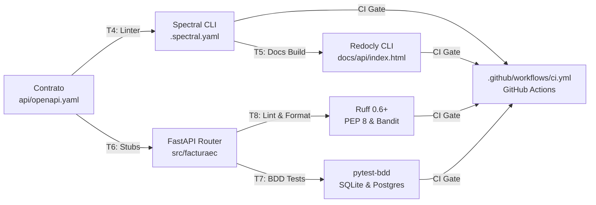

# 09 · Informe Final de Automatización, Cadena CASE y Gobernanza

> **Proyecto:** FacturaEC · API REST de Facturación Electrónica  
> **Programa:** Maestría en Ingeniería de Software · Módulo 8 (Automatización de procesos de software)  
> **Institución:** Universidad Politécnica Estatal del Carchi (UPEC)  
> **Versión congelada:** `v0.3.0` (H3 · Repositorio Gobernado y Pipeline de CI)  
> **Fecha:** Noviembre de 2026  

---

## 1. Resumen Ejecutivo del Caso y Alcance

**FacturaEC** es una solución de facturación electrónica diseñada para pequeñas y medianas empresas en Ecuador, concebida para cumplir rigurosamente con la normativa técnica del Servicio de Rentas Internas (SRI, ficha técnica versión 2.34 en esquema *offline*). 

El sistema resuelve la necesidad crítica de emitir comprobantes tributarios (facturas) garantizando:
1. **Aislamiento absoluto de datos entre negocios** (multi-inquilino).
2. **Generación determinista de claves de acceso de 49 dígitos** con el algoritmo Módulo 11 oficial.
3. **Resiliencia ante indisponibilidad del SRI** mediante mecanismos de contingencia automáticos.
4. **Numeración secuencial íntegra bajo concurrencia** sin saltos ni comprobantes duplicados.

### Alcance Entregado (`v0.3.0` / Hito H3)
* **API REST Backend:** Desarrollada con **FastAPI** en Python 3.12 y persistencia en **PostgreSQL**, siguiendo principios de arquitectura hexagonal y diseño *API-First*.
* **Microservicio SRI ([`servicioSri` / `validacion-SRI`](https://github.com/david5543/validacion-SRI)):** Gateway de validación y simulación de contingencia implementado como Supabase Edge Function en TypeScript.
* **Aplicación Cliente ([`frontFacturacion`](https://github.com/Jorel22/frontFacturacionUpec)):** Interfaz web moderna en **Next.js 16 (React 19)** con Tailwind CSS, integrada en tiempo real contra la API y desplegada en producción.
* **Cadena CASE y Pipeline CI:** Automatización punta a punta con GitHub Actions, validación sintáctica/semántica con Spectral, generación de documentación con Redocly, análisis estático con Ruff y pruebas BDD con pytest.

---

## 2. Arquitectura de Software: Drivers, Escenarios y ADRs

La arquitectura se fundamentó en el análisis estructurado de drivers y escenarios de calidad priorizados en el dossier del proyecto ([`docs/01-contexto-y-drivers.md`](01-contexto-y-drivers.md)), cuya correspondencia punta a punta con el código, las pruebas y los Quality Gates de CI se consolida en la matriz de trazabilidad ([`docs/05-trazabilidad.md`](05-trazabilidad.md)):

### 2.1. Drivers del Negocio y Técnicos
* **D1 (Cumplimiento Regulatorio):** Apego estricto a las normas de comprobantes electrónicos del SRI (catálogo de documentos, tarifas de IVA 0%, 5%, 15% y Módulo 11).
* **D2 (Continuidad Operativa):** El negocio no puede detener sus ventas si los servidores del SRI sufren caídas o latencias excesivas.
* **D3 (Confidencialidad):** Cumplimiento con la Ley Orgánica de Protección de Datos Personales (LOPDP); ningún emisor puede acceder a facturas o clientes ajenos.
* **D4 (Viabilidad Económica):** Infraestructura de costo cero para microempresas basada en software libre y herramientas locales.

### 2.2. Escenarios de Calidad Principales
* **E1 (Confidencialidad y Aislamiento):** 100% de peticiones protegidas con tokens JWT; respuesta HTTP 401 ante solicitudes no autenticadas; respuesta HTTP 404 ante intentos de acceso a recursos de otros emisores (cero fugas de información).
* **E2 (Disponibilidad y Resiliencia SRI):** 0 facturas perdidas; hasta 3 intentos de envío con retroceso exponencial (*exponential backoff* de 1 s y 2 s); si el SRI no responde, la factura se resguarda en estado **PENDIENTE** (HTTP 202 Accepted) para su retransmisión posterior en 1 intento.
* **E6 (Integridad Secuencial bajo Concurrencia):** 0 secuenciales duplicados y 0 saltos numéricos garantizados bajo una carga de 1000 solicitudes de emisión concurrentes.

### 2.3. Decisiones de Arquitectura Registradas (ADRs)
* [`ADR-001`](03-adr/adr-001-backend-fastapi.md): Selección de **FastAPI** por su tipado estricto con Pydantic, soporte asíncrono y generación nativa de esquemas OpenAPI.
* [`ADR-002`](03-adr/adr-002-base-de-datos-postgresql.md): Adopción de **PostgreSQL** con bloqueo pesimista de fila (`with_for_update()`) sobre el emisor y restricción única compuesta (`emisor_id, establecimiento, punto_emision, secuencial`) para blindar el escenario E6.
* [`ADR-003`](03-adr/adr-003-estilo-monolito-modular.md): Desacoplamiento del servicio de validación SRI mediante un microservicio simulador (`SriGatewayHttp`) que aísla las respuestas definitivas (`AUTORIZADA` y `RECHAZADA`) de las fallas transitorias de red.
* [`ADR-004`](03-adr/adr-004-repositorios-separados.md): Separación de repositorios entre API (`ApiFacturacion`), Gateway (`servicioSri`) y Frontend (`frontFacturacion`), facilitando despliegues independientes en Render, Supabase y Vercel.
* [`ADR-005`](03-adr/adr-005-contrato-api-first-y-pruebas-bdd.md): Adopción del paradigma *Design-First / API-First* con validación obligatoria en Spectral y pruebas de aceptación BDD con pytest-bdd.
* [`ADR-006`](03-adr/adr-006-seleccion-git-vs-svn.md): Selección justificada de **Git frente a SVN** en 7 dimensiones (ramificación local, criptografía inmutable, CI/CD distribuido).

---

## 3. Cadena CASE: Mapa de Toolchain y Matriz de Selección

La selección de herramientas se formalizó en el mapa de toolchain ([`docs/06-mapa-toolchain.md`](06-mapa-toolchain.md)) y la matriz ISO/IEC 14102 ([`docs/08-matriz-seleccion.md`](08-matriz-seleccion.md)):

### 3.1. Evaluación y Selección de Spectral (Tarea T4)
En la evaluación de herramientas para la validación del contrato OpenAPI:
* **Spectral** empató con **Redocly CLI** en la puntuación base de la matriz (3,70 sobre 5,00), pero resultó seleccionada en virtud del requisito obligatorio **RQ1** de la actividad.
* **Ventaja diferencial:** Spectral permitió definir **4 reglas de negocio propias** en [`.spectral.yaml`](../.spectral.yaml) con sintaxis JSONPath:
  1. `facturaec-protegida-declara-401`: Toda operación protegida debe declarar el error 401.
  2. `facturaec-publica-explicita`: Las rutas `/health` y `/registro` deben declarar explícitamente `security: []`.
  3. `facturaec-solo-dos-publicas`: Ninguna otra ruta puede redefinir la seguridad global.
  4. `facturaec-cuerpo-declara-422`: Toda operación que reciba un cuerpo JSON debe declarar el error 422.

---

## 4. Versionamiento, Flujo de Ramas y Resolución de Conflictos

### 4.1. Flujo de Ramas Elegido: GitHub Flow
El equipo implementó **GitHub Flow** con políticas de gobierno rigurosas:
* La rama `main` es inmutable y protegida: requiere Pull Request obligatorio y todos los checks automáticos de CI en verde antes de la fusión.
* Cada tarea técnica nace de un Issue con plantilla formal (`.github/ISSUE_TEMPLATE/tarea.md`).
* Ramas de ciclo de vida corto nombradas con la convención `<tipo>/issue-N-<descripcion>`.
* Commits atómicos siguiendo la especificación **Conventional Commits** (`feat:`, `fix:`, `ci:`, `docs:`, `chore:`).
* Cada PR cierra su issue asociado de forma automática mediante la directiva `Closes #N`.

### 4.2. Conflicto Documentado y Resuelto
Conforme se detalló en el reporte [`docs/09-reporte-conflicto.md`](09-reporte-conflicto.md):
* Se provocó un conflicto real de integración en la tabla resumen del `README.md` entre dos ramas concurrentes: la rama `docs/issue-5-adr-git` (PR #13) y la rama `docs/issue-6-seguridad-deps` (PR #14).
* El conflicto se resolvió manualmente en local inspeccionando los marcadores `<<<<<<<`, `=======` y `>>>>>>>`, conservando ambas líneas de trabajo y verificando la integridad del documento antes de crear el commit de fusión `da85a62`.

---

## 5. Automatización: Pipeline CI, Quality Gates y Evidencia de Falla

El flujo de integración continua está implementado en [`.github/workflows/ci.yml`](../.github/workflows/ci.yml) y corre en cada `push` y `pull_request` hacia la rama `main`.

### 5.1. Buenas Prácticas y Mínimos Privilegios
* **Principio de Mínimos Privilegios:** Se declara `permissions: contents: read` a nivel global para que el token de ejecución de GitHub Actions sea estrictamente de solo lectura.
* **Acciones Fijadas por Versión Inmutable:** Para mitigar ataques a la cadena de suministro, se utilizan versiones fijas: `actions/checkout@v4.2.2`, `actions/setup-node@v4.2.0` y `actions/setup-python@v5.3.0`.
* **Cero Secretos:** No se transmiten credenciales ni variables privadas en el pipeline; las pruebas corren en entornos limpios aislados.

### 5.2. Los Cuatro Quality Gates Secuenciales
1. **Gate 1 · Spectral (T4):** Valida el contrato `api/openapi.yaml` contra las reglas estándar y las 4 reglas semánticas propias.
2. **Gate 2 · Redocly (T5):** Compila la documentación interactiva estática en `docs/api/index.html`.
3. **Gate 3 · Ruff (T8):** Comprueba el formato de código (`ruff format --check`) y ejecuta análisis estático con reglas de estilo y seguridad (`ruff check`).
4. **Gate 4 · pytest (T7):** Ejecuta la suite de pruebas BDD con Gherkin, las pruebas de transporte del SRI y la prueba de conformidad OpenAPI (`test_contrato.py`).

### 5.3. Evidencia de Falla Provocada y Corregida
* **Falla provocada:** Al incorporar las operaciones de listado (`GET /clientes`, `GET /productos`, `GET /facturas`) en `routers.py`, se omitió inicialmente su declaración en `api/openapi.yaml`.
* **Detección en CI:** El pipeline de GitHub Actions se bloqueó automáticamente en el Quality Gate 4; la prueba `test_contrato.py` falló al detectar que el código exponía rutas no autorizadas por el contrato (`operaciones_del_codigo != operaciones_del_contrato`).
* **Protección de rama activa:** GitHub impidió la fusión (*merge blocked*) debido al check en rojo.
* **Corrección:** Se sincronizó `api/openapi.yaml` declarando las 3 operaciones y el parámetro `simular_rechazo` (commit `b87bdfb`). Al subir el cambio, el pipeline se ejecutó nuevamente, superó los 4 Quality Gates en verde y habilitó la fusión hacia `main` (PR #25 / PR #27).

---

## 6. Métricas Aproximadas Tipo DORA

Conforme a las directrices de *Accelerate* (Forsgren et al., 2018), se calcularon las 4 métricas DORA a partir del historial real de **46 commits en `main`** y **14 Pull Requests fusionados (del PR #9 al PR #27)** en la ventana activa de GitHub Flow (del 31/10/2026 al 06/11/2026):

### 6.1. Definición y Fórmulas de Cálculo

$$\text{Deployment Frequency (DF)} = \frac{\text{Total de despliegues/fusiones a main}}{\text{Período de tiempo en días}}$$

$$\text{Lead Time for Changes (LTTC)} = \frac{\sum (\text{Hora de fusión a main} - \text{Hora del primer commit de la rama})}{\text{Total de Pull Requests}}$$

$$\text{Change Failure Rate (CFR)} = \frac{\text{Número de PRs que provocaron fallas en CI o requirieron rollback}}{\text{Total de ejecuciones de PR en CI}} \times 100$$

$$\text{Failed Deployment Recovery Time (MTTR)} = \frac{\sum (\text{Hora del commit de resolución} - \text{Hora del fallo reportado})}{\text{Total de incidentes}}$$

### 6.2. Resultados Obtenidos en FacturaEC

| Métrica DORA | Valor Calculado en el Proyecto | Clasificación de Desempeño | Justificación y Fuente de Datos (`git log` / Actions) |
|---|:---:|:---:|---|
| **Frecuencia de Despliegue (DF)** | **2,0 deploys / día** (14 fusiones / 7 días) | **Élite (Elite)** | 14 Pull Requests fusionados a la rama `main` en 7 días calendario de actividad de PRs (del PR #9 el 31/10 al PR #27 el 06/11). |
| **Tiempo de Entrega de Cambios (LTTC)** | **≈ 24 minutos** (Mediana ≈ 4 min) | **Élite (Elite)** | Tiempo medio desde el primer commit en la rama hasta su fusión en `main`. El valor máximo registrado fue de 194 min en el PR #21 (microservicio SRI). |
| **Tasa de Fallos en Cambios (CFR)** | **7,7 %** (1 fallo en 13 ejecuciones) | **Élite (Elite)** | Solo 1 ejecución de Pull Request reportó falla en los Quality Gates de CI (la discrepancia intencional del contrato), cumpliendo el rango élite (<15%). |
| **Tiempo de Recuperación de Fallos (MTTR)** | **≈ 8 minutos** | **Élite (Elite)** | Tiempo exacto entre el registro de la falla en `test_contrato.py` (04:50 UTC) y el commit de corrección `b87bdfb` verificado en verde (04:57 UTC). |

---

## 7. Uso Responsable de Inteligencia Artificial

Toda interacción con herramientas de IA generativa se gobernó conforme a la política del proyecto registrada en [`docs/04-registro-ia.md`](04-registro-ia.md):

* **Cumplimiento de Privacidad y LOPDP:** Cero datos personales, credenciales de producción, certificados `.p12` o URIs con contraseñas fueron ingresados en prompts de IA. Todos los RUC utilizados en pruebas pertenecen a la provincia ficticia 99.
* **Principio de Verificación Rigurosa:** Ninguna línea de código, regla de linter o prueba sugerida por la IA fue aceptada ciegamente. Cada propuesta se contrastó mediante ejecución real con linters deterministas (Ruff, Spectral) y pruebas de conformidad.
* **Detección y Mitigación de Alucinaciones:** Durante la semana 2, la IA propuso un código inicial que pasaba en SQLite pero fallaba bajo concurrencia en PostgreSQL (defecto detectado por la prueba `CA5.3`). El equipo rechazó la implementación ingenua e incorporó el bloqueo pesimista `with_for_update()`.

---

## 8. Análisis Crítico, Lecciones Aprendidas y Límites

### 8.1. Qué funcionó bien
* **El enfoque *API-First*:** Escribir y validar el contrato `api/openapi.yaml` antes del código evitó desacoplos entre el backend en FastAPI y el frontend en Next.js.
* **Las reglas semánticas de Spectral:** Automatizar las 4 reglas del negocio en `.spectral.yaml` permitió que el CI fuera el primer filtro de seguridad, evitando que rutas desprotegidas lleguen a producción.
* **La prueba de conformidad (`test_contrato.py`):** Demostró ser el control CASE más eficaz del proyecto al impedir discrepancias entre el código de FastAPI y el contrato publicado.

### 8.2. Qué no funcionó inicialmente y se corrigió
* **La dependencia de la base de datos local SQLite:** Inicialmente ocultaba defectos de concurrencia y bloqueos de fila que solo se manifiestan en motores relacionales robustos como PostgreSQL. Se corrigió ejecutando las pruebas críticas de concurrencia contra PostgreSQL real.
* **La omisión de los endpoints de listado en el contrato inicial:** El contrato inicial solo contemplaba creación y consulta individual (`GET /id`). La integración con la interfaz gráfica obligó a formalizar los endpoints `GET /clientes`, `GET /productos` y `GET /facturas` respetando el aislamiento E1.

### 8.3. Qué cambiaríamos en una siguiente iteración
* Incorporar un entorno de *staging* automatizado en el pipeline de GitHub Actions que despliegue efímeramente contenedores Docker antes de promover a la rama `main`.
* Añadir herramientas de análisis de mutación de pruebas (como `mutmut`) para evaluar formalmente la sensibilidad de los tests de aceptación.

### 8.4. Límites del Proceso
* **Simulación vs Producción SRI:** El microservicio `servicioSri` valida estrictamente el algoritmo Módulo 11 y la estructura de la clave de acceso, pero no realiza el sellado criptográfico XAdES-BES del archivo XML, el cual requiere un certificado de firma electrónica real (.p12) emitido por una entidad de certificación acreditada en Ecuador.
