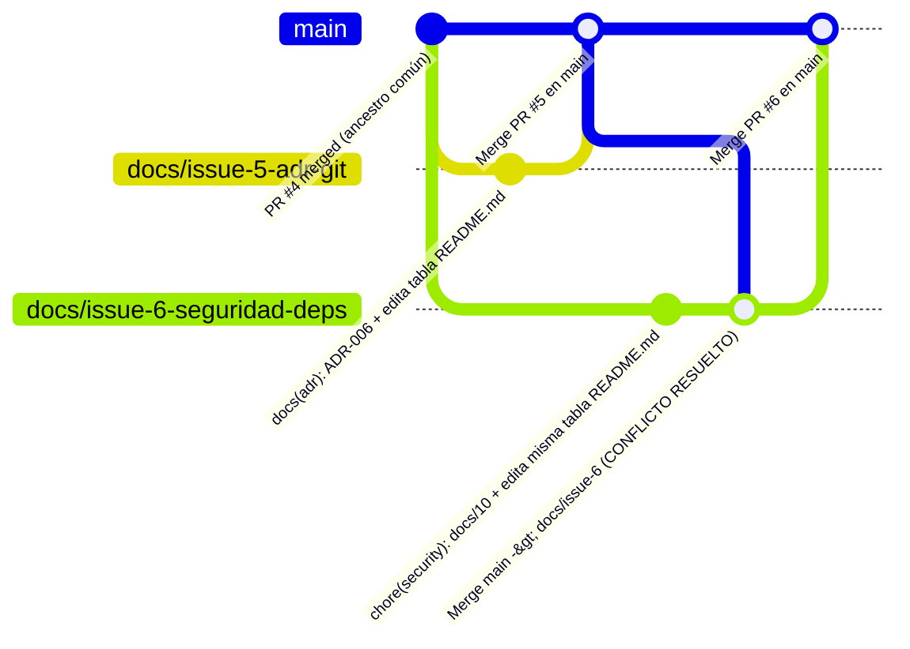

# 09 · Reporte de conflicto de integración (Merge Conflict)

- **Proyecto:** FacturaEC · API de facturación electrónica
- **Versión:** v0.3.0 (Semana 3 · Repositorio gobernado)
- **Fecha:** 2026-11-01
- **Ramas involucradas:** `docs/issue-5-adr-git` (PR #5, fusionada primero en `main`) y `docs/issue-6-seguridad-deps` (PR #6, en conflicto al actualizarse contra `main`)
- **Archivo afectado:** [`README.md`](../README.md) (tabla de índice documental, líneas 25 a 36)

---

## 1. Causa técnica del conflicto

Durante el trabajo paralelo del hito `v0.3.0`, dos integrantes crearon sus ramas de trabajo cortas a partir del mismo commit ancestro común en `main` (posterior a la integración del PR #4):

1. **Rama A (`docs/issue-5-adr-git`, Luis Cisneros):** se bifurcó desde `main` para documentar el ADR de selección de Git frente a SVN (`docs/03-adr/adr-006-seleccion-git-vs-svn.md` y actualización de `adr-004`). En esa misma rama se editó la tabla de documentos de `README.md` para actualizar la fila de `docs/03-adr/` y añadir el enlace a la matriz `docs/08-matriz-git-vs-svn.md`.
2. **Rama B (`docs/issue-6-seguridad-deps`, Jordan Montenegro):** se bifurcó desde el **mismo commit base** de `main` para documentar la auditoría de seguridad y dependencias (`docs/10-gobierno-seguridad-y-dependencias.md`). En paralelo, modificó exactamente las mismas líneas al final de la tabla de documentos de `README.md` para agregar el enlace a `docs/10-gobierno-seguridad-y-dependencias.md` y a `CONTRIBUTING.md`.

Cuando el **PR #5** (`docs/issue-5-adr-git`) fue revisado, aprobado y fusionado en `main`, la punta de `main` avanzó. Al intentar fusionar `main` dentro de la rama `docs/issue-6-seguridad-deps` (`git merge origin/main`), el algoritmo de fusión de tres vías (*three-way merge*) de Git detectó cambios divergentes sobre el mismo bloque contiguo de líneas en `README.md` respecto al ancestro común (*merge base*), detuvo la fusión automática y marcó el archivo en estado `Unmerged` (`both modified`).



---

## 2. Marcadores de conflicto generados por Git

Al ejecutar `git fetch origin` seguido de `git merge origin/main` estando en la rama `docs/issue-6-seguridad-deps`, Git emitió la siguiente salida en consola:

```text
Auto-merging README.md
CONFLICT (content): Merge conflict in README.md
Automatic merge failed; fix conflicts and then commit the result.
```

Al inspeccionar `README.md`, Git insertó los delimitadores estándar de conflicto de fusión (`<<<<<<<`, `=======`, `>>>>>>>`) entre las líneas 29 y 41:

```markdown
| [`docs/01-contexto-y-drivers.md`](docs/01-contexto-y-drivers.md) | Contexto, stakeholders, drivers, escenarios E1–E8 y matriz de estilos (v0.1.0) |
| [`docs/02-vistas-c4/`](docs/02-vistas-c4/) | Vistas C4 como código (Mermaid) |
<<<<<<< HEAD
| [`docs/03-adr/`](docs/03-adr/) | ADR-001 a ADR-005 (nuevo: contrato API-first y pruebas BDD) |
| [`docs/04-registro-ia.md`](docs/04-registro-ia.md) | Registro de uso de IA, con la verificación de cada artefacto |
| [`docs/06-mapa-toolchain.md`](docs/06-mapa-toolchain.md) | Proceso, 10 tareas puntuadas, herramientas por fase y pruebas de herramientas |
| [`docs/07-historias-y-criterios.md`](docs/07-historias-y-criterios.md) | Historias, criterios en Gherkin y matriz de trazabilidad |
| [`docs/08-matriz-seleccion.md`](docs/08-matriz-seleccion.md) | Evaluación y selección de herramientas (ISO/IEC 14102) |
| [`docs/10-gobierno-seguridad-y-dependencias.md`](docs/10-gobierno-seguridad-y-dependencias.md) | Controles de gobierno de ramas, verificación de secretos y auditoría de dependencias |
| [`CONTRIBUTING.md`](CONTRIBUTING.md) | Flujo de trabajo gobernado, convención de ramas y lista de verificación de PR |
| [`api/openapi.yaml`](api/openapi.yaml) | Contrato de la API (fuente de verdad) |
=======
| [`docs/03-adr/`](docs/03-adr/) | ADR-001 a ADR-006 (incluye selección de Git frente a SVN y topología de repositorios) |
| [`docs/04-registro-ia.md`](docs/04-registro-ia.md) | Registro de uso de IA, con la verificación de cada artefacto |
| [`docs/06-mapa-toolchain.md`](docs/06-mapa-toolchain.md) | Proceso, 10 tareas puntuadas, herramientas por fase y pruebas de herramientas |
| [`docs/07-historias-y-criterios.md`](docs/07-historias-y-criterios.md) | Historias, criterios en Gherkin y matriz de trazabilidad |
| [`docs/08-matriz-seleccion.md`](docs/08-matriz-seleccion.md) | Evaluación y selección de herramientas CASE (ISO/IEC 14102) |
| [`docs/08-matriz-git-vs-svn.md`](docs/08-matriz-git-vs-svn.md) | Matriz comparativa en 7 dimensiones entre Git y Apache Subversion (SVN) |
| [`api/openapi.yaml`](api/openapi.yaml) | Contrato de la API (fuente de verdad) |
>>>>>>> origin/main
```

### Interpretación de las secciones del bloque en conflicto

- **`<<<<<<< HEAD` a `=======`:** representa el estado en la rama local actual (`docs/issue-6-seguridad-deps`), donde se habían agregado las filas de `docs/10-gobierno-seguridad-y-dependencias.md` y `CONTRIBUTING.md`, manteniendo la descripción previa de `docs/03-adr/`.
- **`=======` a `>>>>>>> origin/main`:** representa los cambios entrantes desde `main` (introducidos por el PR #5 ya fusionado), donde se actualizó la fila de `docs/03-adr/` (ADR-001 a ADR-006) y se añadió la fila de `docs/08-matriz-git-vs-svn.md`.

---

## 3. Pasos ejecutados para resolver el conflicto

Dado que ambos cambios eran aditivos y legítimos (ninguna rama debía sobrescribir ni descartar los enlaces agregados por la otra), se aplicó una **resolución integradora** siguiendo estos pasos:

1. **Sincronización local del estado remoto:**
   ```bash
   git checkout docs/issue-6-seguridad-deps
   git fetch origin
   git merge origin/main
   ```
2. **Inspección del conflicto:**
   ```bash
   git status
   git diff README.md
   ```
3. **Edición manual de `README.md` y eliminación de marcadores:**
   Se conservaron tanto la actualización de `docs/03-adr/` y la fila de `docs/08-matriz-git-vs-svn.md` (provenientes de `origin/main` / PR #5) como las filas de `docs/10-gobierno-seguridad-y-dependencias.md` y `CONTRIBUTING.md` (provenientes de `docs/issue-6-seguridad-deps`), ordenadas numéricamente y eliminando por completo las líneas `<<<<<<< HEAD`, `=======` y `>>>>>>> origin/main`:

   ```markdown
   | [`docs/01-contexto-y-drivers.md`](docs/01-contexto-y-drivers.md) | Contexto, stakeholders, drivers, escenarios E1–E8 y matriz de estilos (v0.1.0) |
   | [`docs/02-vistas-c4/`](docs/02-vistas-c4/) | Vistas C4 como código (Mermaid) |
   | [`docs/03-adr/`](docs/03-adr/) | ADR-001 a ADR-006 (incluye selección de Git frente a SVN y topología de repositorios) |
   | [`docs/04-registro-ia.md`](docs/04-registro-ia.md) | Registro de uso de IA, con la verificación de cada artefacto |
   | [`docs/06-mapa-toolchain.md`](docs/06-mapa-toolchain.md) | Proceso, 10 tareas puntuadas, herramientas por fase y pruebas de herramientas |
   | [`docs/07-historias-y-criterios.md`](docs/07-historias-y-criterios.md) | Historias, criterios en Gherkin y matriz de trazabilidad |
   | [`docs/08-matriz-seleccion.md`](docs/08-matriz-seleccion.md) | Evaluación y selección de herramientas CASE (ISO/IEC 14102) |
   | [`docs/08-matriz-git-vs-svn.md`](docs/08-matriz-git-vs-svn.md) | Matriz comparativa en 7 dimensiones entre Git y Apache Subversion (SVN) |
   | [`docs/10-gobierno-seguridad-y-dependencias.md`](docs/10-gobierno-seguridad-y-dependencias.md) | Controles de gobierno de ramas, verificación de secretos y auditoría de dependencias |
   | [`CONTRIBUTING.md`](CONTRIBUTING.md) | Flujo de trabajo gobernado, convención de ramas y lista de verificación de PR |
   | [`api/openapi.yaml`](api/openapi.yaml) | Contrato de la API (fuente de verdad) |
   ```

4. **Verificación de marcadores residuales y suite de pruebas local:**
   ```bash
   git diff --check
   pytest
   ruff check src tests
   ```
   `git diff --check` confirmó que no quedaron marcadores de conflicto ni espacios en blanco inválidos, y `pytest` ejecutó las 30 pruebas en SQLite sin fallos.

5. **Registro del commit de resolución y envío a la rama del PR #6:**
   ```bash
   git add README.md
   git commit -m "chore(docs): resolver conflicto de fusion en tabla de README entre PR #5 y PR #6"
   git push origin docs/issue-6-seguridad-deps
   ```
   Con este commit de fusión en la rama `docs/issue-6-seguridad-deps`, GitHub verificó que el PR #6 ya no presentaba conflictos con `main`, ejecutó el workflow de integración continua (`ci.yml`) en verde y habilitó la fusión tras la revisión cruzada.

---

## 4. Medidas de prevención adoptadas por el equipo

Para reducir la frecuencia de conflictos de fusión no planificados en los siguientes hitos de **FacturaEC**:

1. **Ramas de vida corta (< 48 horas) y alcance atómico:** cada rama resuelve un único Issue acotado a un módulo o documento específico (`src/facturaec/modules/<modulo>` o un archivo puntual en `docs/`), evitando que múltiples ramas abiertas modifiquen simultáneamente archivos compartidos de índice (`README.md`, `CHANGELOG.md`).
2. **Sincronización frecuente con `origin/main`:** antes de abrir un Pull Request y después de que cualquier compañero fusione un PR en `main`, los integrantes con ramas activas ejecutan `git fetch origin && git merge origin/main` para detectar divergencias tempranamente cuando el delta es de pocas líneas.
3. **Actualización centralizada de índices al cierre del hito:** los archivos índice transversales (`README.md` y `CHANGELOG.md`) se consolidan preferentemente en el PR de cierre de versión (`v0.x.0`) o tras coordinar el orden de fusión en el tablero de Issues.
4. **Verificación automática en CI (`git diff --check`):** el flujo de GitHub Actions y la lista de verificación de `.github/pull_request_template.md` impiden fusionar archivos que contengan marcadores `<<<<<<<`, `=======` o `>>>>>>>` sin resolver.
